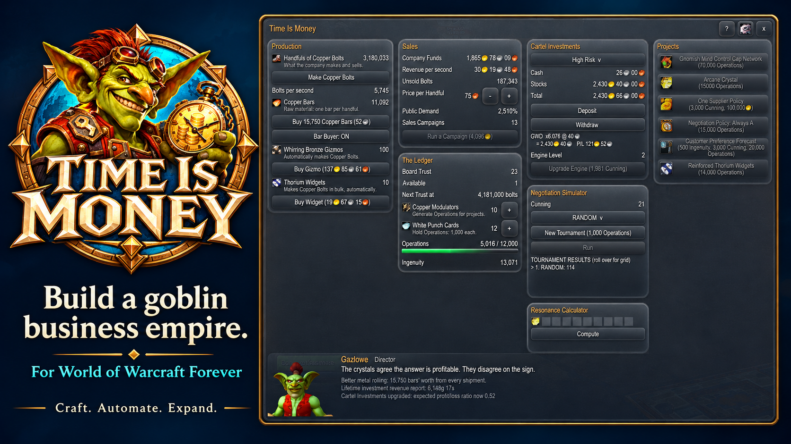

# Time Is Money

> A goblin company teaches an enchanted ledger to make bolts. The ledger gets very good at its job.

A single-player mini-game for World of Warcraft: Forever, based on *Universal
Paperclips* by Frank Lantz and told as goblin industrial satire in Liquid Glass.
You start with a handful of Copper Bolts. Then you see how far "just one more
upgrade" takes you.

**Version 1.0.0** ([changelog](https://github.com/Spotnick2/TimeIsMoney/blob/main/CHANGELOG.md)).
Get it from CurseForge, Wago Addons or the
[GitHub releases](https://github.com/Spotnick2/TimeIsMoney/releases).

## What it does

- **The whole game.** All three phases and all 96 projects, plus investments,
  strategic tournaments, the planet and the stars, battles, both prestige routes and
  every ending. The numbers match the original game.
- **The ledger window.** Cards appear as the company grows, with a "New" tag on what
  just arrived. Every button, item and card title has a tooltip. Anything you can't
  afford yet says why, and where the missing resource comes from.
- **Gazlowe, your Director.** His animated model greets you when the ledger opens,
  talks when reports arrive, and now and then offers a deal. Click him (or the
  reports) for the report history. A 2D portrait is available in Settings.
- **Pause.** /tim pause, or the button in Settings, stops the company until you
  resume it.
- **Settings.** Gazlowe's model or portrait, his voice, the report sound, the minimap
  button, the window scale and a new game.

## Playing

1. Install the TimeIsMoney folder into the Forever client's `Interface\AddOns`
   folder, then restart the game.
2. Type **/tim start** to found your company. The ledger and a short help page open.
3. After that, **/tim** or a click on the minimap button opens and closes the ledger
   (right-click opens the settings). The company keeps working while the window is
   closed.

**Commands:** /tim start, /tim (open or close the ledger), /tim pause,
/tim settings, /tim reports, /tim minimap, /tim help, /tim status.

## Good to know

- **Everything is simulated.** Company funds and materials belong to the game. It
  never touches your gold, your bags, your professions or the Auction House.
- **Saving.** Progress is saved when you log out or /reload. A crash or forced close
  can lose progress since the last save.
- **No offline progress.** The company works only while you are logged in. Closing
  the window doesn't pause it; only Pause does (/tim pause or Settings).
- **One company per account.** Every character shares it.

Found a bug? Open an issue on
[GitHub](https://github.com/Spotnick2/TimeIsMoney/issues), with /tim status's
output and any Lua error (`/console scriptErrors 1` shows them).

## Credits & Legal

Frank Lantz, Chair of the NYU Game Center, created *Universal Paperclips*. His site
is [franklantz.net](https://www.franklantz.net/).

Bennett Foddy is credited in the original game for its combat programming, which
this addon's battles reproduce.

This is an unofficial, non-commercial fan project. Its core logic and math are
derived from the original game at
[decisionproblem.com](https://www.decisionproblem.com/paperclips/). Please support
the creator by playing or purchasing the official version.

The addon's in-game help credits the original and links to it. See
[LICENSE](https://github.com/Spotnick2/TimeIsMoney/blob/main/LICENSE) for the
third-party notice: the MIT License covers this addon's original code, not the
Universal Paperclips IP, narrative text or game logic, and not Blizzard's assets.
The glass is [LibGlass-1.0](https://github.com/Spotnick2/LibGlass) (MIT).

## Developing

- [Implementation spec](https://github.com/Spotnick2/TimeIsMoney/blob/main/docs/plan/Time-Is-Money-Implementation-Spec.md)
  and [creative brief](https://github.com/Spotnick2/TimeIsMoney/blob/main/docs/plan/Time-Is-Money-Original-Plan.md);
  original concepts in the [storyboards](https://github.com/Spotnick2/TimeIsMoney/tree/main/docs/storyboard).
- [Roadmap and issue catalog](https://github.com/Spotnick2/TimeIsMoney/blob/main/docs/BACKLOG.md).
- [Pure-Lua simulation](https://github.com/Spotnick2/TimeIsMoney/blob/main/docs/reference/WORKSHOP.md),
  its [client host adapter](https://github.com/Spotnick2/TimeIsMoney/blob/main/docs/HOST.md)
  and [saved games](https://github.com/Spotnick2/TimeIsMoney/blob/main/docs/SAVES.md).
- [Releases](https://github.com/Spotnick2/TimeIsMoney/blob/main/docs/RELEASE.md), the
  [release acceptance matrix](https://github.com/Spotnick2/TimeIsMoney/blob/main/docs/ACCEPTANCE.md)
  and [project traceability](https://github.com/Spotnick2/TimeIsMoney/blob/main/docs/reference/PROJECTS.md).
- [Animated goblin Director](https://github.com/Spotnick2/TimeIsMoney/blob/main/docs/MODELS.md),
  using AltStable's roster pet renderer.
- [References and evidence](https://github.com/Spotnick2/TimeIsMoney/blob/main/docs/REFERENCES.md).
- [Agent instructions](https://github.com/Spotnick2/TimeIsMoney/blob/main/CLAUDE.md),
  also reached through [AGENTS.md](https://github.com/Spotnick2/TimeIsMoney/blob/main/AGENTS.md).

Target: Forever Interface 16001; API evidence build 1.60.1.70338; offline Lua 5.1.
Validate with **pwsh tests/run.ps1**; deploy with **pwsh Tools/deploy.ps1**, which
defaults to the `_forever_` AddOns folder. Restart after first installing, enable
script errors, then run /tim status.

GitHub issues are the work queue; changes use PRs. The owner runs reviews and merges.
CI checks the original design bytes, the Lua tests, the Windows test and deploy
tooling, and the package; a tag publishes the checked zip as a GitHub Release and on
Wago Addons.
